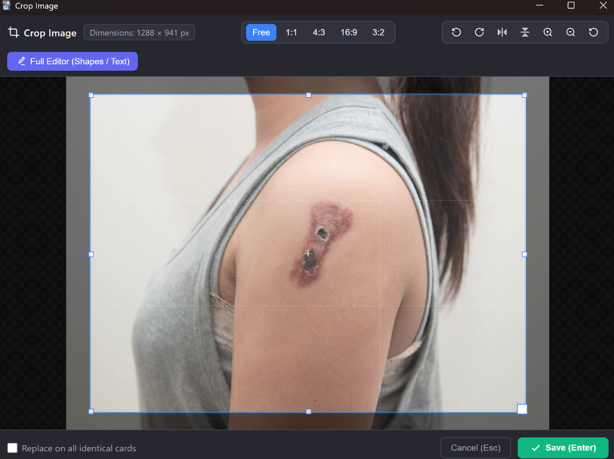

# Image Editor Enhanced — Fast Crop, Annotate & Medical Image Tools

An advanced, high-performance image editing, cropping, and annotation add-on for Anki. Crop, rotate, straighten, redact, annotate, and invert medical illustrations directly within the Note Editor in seconds without interrupting your review or card creation workflow.

---

## Key Enhancements vs Original Add-on (789309990)

| Feature | Original Upstream (789309990) | Enhanced Edition |
| :--- | :--- | :--- |
| **Instant Cropper Tool** | Not available (only full SVG canvas) | **Built-in fast cropper** with aspect ratio presets (Free, 1:1, 4:3, 16:9, 3:2), lossless rotations (-90° / +90°), horizontal/vertical flips, and zoom |
| **In-Place Medical Redaction & Blackout** | Requires external editing | **Instant blackout tool** directly in cropper to redact patient names or identifiers |
| **Quick Annotations on Cropper** | Requires launching vector editor | **Integrated pointer arrows, focus frames, and highlighters** without switching windows |
| **Fine Tilt / Straighten Slider** | 90° increments only | **Precision tilt slider (-45° to +45°)** to straighten crooked scans or textbook photos |
| **Medical Filters (Invert / Contrast)** | None | **Instant Negative / Invert filter** for X-rays and CT scans, plus High Contrast & Grayscale |
| **Lossless Full Editor Switch** | Cropped state was discarded | **Seamless handoff**: cropped canvas and in-place annotations carry over directly into Method-Draw |
| **Floating Popover Integration** | Not supported | **Targeted quick-action button** in Anki's floating image bubble menu |
| **Native Settings Dialog & config.md** | Blocked with "no config" tooltip | **Dedicated Qt settings interface** and comprehensive native `config.md` documentation |
| **Internationalization (i18n)** | English only | **Native translation into over 40 Anki languages** with automatic locale detection |
| **Design & Ergonomics** | Cluttered / inconsistent palettes | **Sober, clinical-grade dark interface** conforming to `/kill-ai-slop` (zero emojis) |

---

## Screenshot

---

## How to Use

1. **Floating Toolbar**: Select an image and click the Image Editor icon in the floating bubble toolbar.
2. **Context Menu**: Right-click any image and choose *Image Editor (Crop / Edit)*.
3. **Toolbar Button / Shortcut**: Press `Ctrl + Shift + I` to edit the selected image, or open a blank canvas to create a new vector drawing from scratch.
4. **Fast Crop & In-Place Tools**:
   - Choose a ratio preset or adjust the crop box.
   - Use the **Redact** tool (`B`) to mask sensitive information.
   - Use the **Arrow** tool (`A`), **Frame** tool, or **Highlight** tool for quick indicators.
   - Adjust the **Tilt slider** to straighten misaligned photos.
   - Select **Invert (Negative)** for radiographic images.
5. **Switch to Full Vector Editor**: Click *Full Editor* to carry over your crop and annotations into Method-Draw for complex vector shapes and text labels.

---

## Keyboard Shortcuts

### Global Editor
- `Ctrl + Shift + I`: Open Image Editor on selected image (or create blank drawing). Compatible with *Customize Keyboard Shortcuts Enhanced*.

### Fast Cropper & Annotation Modal
- `Enter`: Save and apply changes.
- `Esc`: Cancel and close dialog.
- `Ctrl + Z`: Undo last drawn annotation.
- `C`: Activate Crop box tool.
- `B`: Activate Redaction / Blackout tool.
- `A`: Activate Pointer Arrow tool.
- `I`: Toggle Invert / Negative filter (radiography mode).
- `R` / `L`: Rotate +90° right / -90° left.
- `H` / `V`: Flip horizontal / vertical.
- `1` to `5`: Aspect ratio presets (Free, 1:1, 4:3, 16:9, 3:2).

---

## Installation

### Via AnkiWeb
1. In Anki, go to **Tools > Add-ons > Get Add-ons...**
2. Enter the Add-on Code: **789309990** (or enhanced edition code: **1177622942**)
3. Restart Anki.

### Manual Installation (.ankiaddon)
1. Download the `.ankiaddon` package from GitHub releases.
2. In Anki, go to **Tools > Add-ons > Install from file...**
3. Select `Image_Editor_Enhanced.ankiaddon` and restart Anki.

---

## Credits & Attribution

This add-on is an enhanced edition building upon the contributions of the Anki open-source community:
- Original author: **BlueGreenMagick** ([GitHub](https://github.com/BlueGreenMagick))
- Upstream maintainer: **Shigeyuki (Shige)** ([AnkiWeb 789309990](https://ankiweb.net/shared/info/789309990) / [Patreon](http://patreon.com/Shigeyuki))
- Source code: [GitHub Repository](https://github.com/Ficello/Anki-Image-Editor-Enhanced-Edition-)

---

## Compatibility

- Anki 2.1.20 up to Anki 23.x / 24.x / 25.x+
- Full Qt5 and Qt6 support
- Windows, macOS, and Linux
